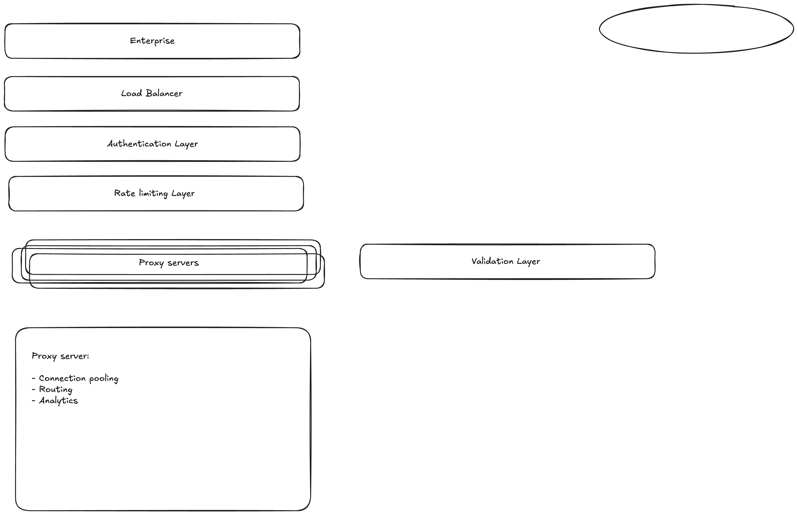

# proxierr

A small LLM proxy in Rust, built on Cloudflare's [Pingora](https://github.com/cloudflare/pingora).
I wrote it in 2024 to learn Pingora's request lifecycle before building a production AI gateway.



## What it does

- Accepts OpenAI style requests (for example `POST /v1/chat/completions`) on port 80.
- Reads the tenant and target provider from request headers (`X-Tenant-ID`, `X-Provider`, `X-Api-Key`).
- Loads providers (OpenAI, Anthropic) from `llm_config.json` and server settings from `conf.yaml`.
- Runs on Pingora's multi-threaded server with an upstream keepalive pool and one retry on connect failure.
- Returns structured JSON errors for malformed requests.

## Status: prototype

This is a learning project, not production code. Honest gaps:

- Upstream selection is hard-coded; provider routing from `llm_config.json` is not wired into `upstream_peer` yet.
- Authentication, authorization and rate limiting are stubs (`authenticate`, `authorize`, `apply_rate_limit`).
- The integration test expects a proxy already running on `localhost:80`.

## Run it

```bash
cargo build --release
sudo ./target/release/proxierr      # binds 0.0.0.0:80
```

Edit `conf.yaml` first: `config_dir`, `error_log` and `pid_file` point at local paths.

```bash
curl http://localhost/v1/chat/completions \
  -H "Content-Type: application/json" \
  -H "X-Tenant-ID: demo" -H "X-Provider: openai" -H "X-Api-Key: <key>" \
  -d '{"model":"gpt-4o-mini","messages":[{"role":"user","content":"hi"}]}'
```

## Layout

```
src/main.rs                    startup, logging, config
src/config/                    conf.yaml loading (runtime and proxy settings)
src/proxy/mod.rs               ProxyHttp impl: request_filter, upstream_peer, retries
src/proxy/request_modifiers.rs header and body rewrites
src/proxy/response.rs          JSON error responses
tests/proxy_test.rs            end to end request through a running proxy
```

## Stack

Rust 2021, Pingora, Tokio, Serde, Clap, Tracing, mimalloc.
